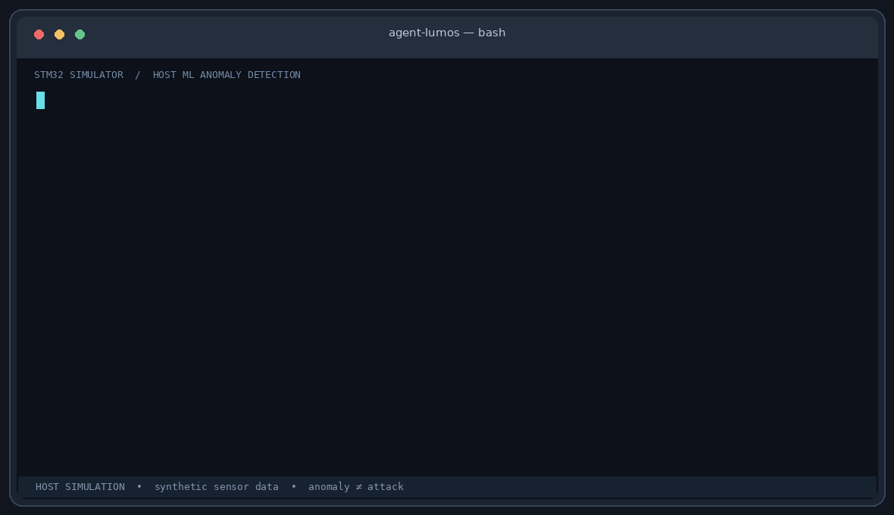

<div align="center">

# AGENT LUMOS

[](https://github.com/sfwoszcz/agent-lumos/actions/workflows/ci.yml)

### A little light on your systems.

## Agent Lumos in Action

### Animated Linux Terminal Demo

<p align="center">
  
</p>

*Animated terminal preview using synthetic STM32 telemetry
and machine-learning evaluation samples.*

### Run It Yourself

```bash
python3 -m venv .venv
source .venv/bin/activate
python -m pip install -e '.[dev,stm32,ml]'

make demo
make ml-demo
make ml-frames
```

**Secure Python monitoring · STM32/C/C++ · x86-64 assembly · CMake · host-side ML**


</div>

> **Portfolio project / educational use only.** Agent Lumos is not a production-ready enterprise RMM platform. Only run it on machines you own or have explicit permission to monitor.

## What is Agent Lumos?

Agent Lumos is a lightweight, object-oriented monitoring agent written in Python. It collects CPU, memory, disk and uptime metrics, exposes a small HTTP API for read-only diagnostics, and can send encrypted telemetry to a receiver. The project emphasizes defensive coding, separation of concerns, authentication, asynchronous I/O, and automated testing. **Version 1.2 adds CMake/Make native build presets, CTest, host sanitizer support, x86-64 and AArch64 ABI learning exercises, and a reproducible host-side ML anomaly-detection demo.** STM32 hardware integration is still unverified.

**Features**

- **Monitoring:** CPU, RAM, disk usage, uptime and hostname via `psutil`.
- **Authentication:** PBKDF2-HMAC-SHA256 password hashing and short-lived (15-minute) HS256 JWTs with scopes, issuer and audience validation.
- **Safe diagnostics:** `whoami`, `uptime`, `disk`, `platform` (fixed Python functions; no arbitrary shell execution).
- **Rate limiting:** 5 login attempts per minute per IP (in memory).
- **Telemetry:** asynchronous `aiohttp` reporting over HTTPS, a bearer token, and optional Fernet payload encryption. Plain HTTP is permitted **only for a local demo receiver**.
- **Secure defaults:** loopback binding, TLS required for remote API binding, no default passwords, private config file, and rotating logs.
- **STM32 extension (v1.1):** CRC-checked, bounded UART telemetry; C11 encoder, C++17 health-policy simulator, Python OOP registry and authenticated read-only API. Hardware reference: NUCLEO-F446RE.
- **Assembly learning:** optional Cortex-M4 Thumb-2 code sample (not used in firmware).
- **Dev experience:** CMake + Make build workflow, CTest + pytest, an optional ASan/UBSan preset, Linux shell demos, and GitHub Actions CI.
- **Host-side ML (v1.2):** `scikit-learn` IsolationForest on synthetic voltage/temperature observations, holdout evaluation, threshold baseline and simulator frame scoring. **Anomalies are not proof of malicious activity.**
- **Architecture examples:** x86-64 System V ABI assembly with a native test; AArch64 and Cortex-M4 examples are provided but are not all compiled on this host.

## Project layout

```text
agent-lumos/
├── .github/workflows/ci.yml      # Python + CMake/CTest + ML on CI
├── .env.example                  # Safe placeholders, not real secrets
├── .gitignore                    # Excludes .env, keys, logs, caches
├── Makefile                     # Friendly native/test/ML/build targets
├── CMakeLists.txt               # Native libraries, simulator, tests
├── CMakePresets.json            # Native, ASan/UBSan, STM32 object presets
├── cmake/toolchains/             # ARM embedded cross-compilation toolchain
├── docs/
│   ├── BUILD.md                 # Toolchain and build/test instructions
│   ├── ML.md                    # Reproducible anomaly demo and limitations
│   ├── ARCHITECTURE.md           # Component diagram and boundaries
│   ├── STM32.md                 # C/C++/Python UART demo and results
│   ├── stm32-demo-output.txt     # Verified native STM32 simulator transcript
│   ├── ml-demo-output.txt        # Verified synthetic ML and frame-scoring output
│   ├── DEMO.md                   # Detailed Linux terminal walkthrough
│   └── demo-output.txt           # Captured, anonymized smoke-test output
├── firmware/stm32/                # C11 protocol + STM32 HAL hook
│   ├── native/                    # C++17 health-policy + simulator
│   ├── asm/                       # Optional ARM Cortex-M4 assembly example
│   └── README.md                  # STM32CubeIDE integration steps
├── scripts/demo.sh               # Live, interactive terminal showcase
├── scripts/stm32_demo.sh         # C/C++ -> Python actual host demo
├── src/agent_lumos/
│   ├── __main__.py               # python -m agent_lumos
│   ├── api.py                    # HTTP endpoints
│   ├── cli.py                    # init, serve, demo-receiver
│   ├── config.py                 # Validated configuration
│   ├── demo_receiver.py          # Local-only collector (for learning)
│   ├── monitor.py                # Metrics and read-only diagnostics
│   ├── security.py               # PBKDF2, JWTs, rate limiting
│   ├── stm32.py                  # Serial parser, CRC, registry, async reader
│   ├── ml.py                    # Typed ML features, synthetic dataset, metrics
│   ├── ml_demo.py               # Standalone ML evaluation and frame scoring
│   └── telemetry.py              # Async reports + Fernet
├── tests/                        # Unit and integration tests
├── LICENSE
├── SECURITY.md
└── pyproject.toml
```

## Quick start (Linux)

Prerequisites: **Python 3.11+**, `pip`, `curl`, and a Linux shell. Run these commands from the root of this repository.

**1. Create a virtual environment and install the project.**

```bash
python3 -m venv .venv
source .venv/bin/activate
python -m pip install --upgrade pip
python -m pip install -e '.[dev]'
```

**2. Create private credentials.**

```bash
agent-lumos init
```

Enter and confirm a **unique password of at least 12 characters**. This creates a local `.env` file containing a salted password hash and randomly generated JWT, telemetry and encryption keys (not the plaintext password). On Linux the file is created with mode `0600`. Never commit `.env` to GitHub.

**3. Start the agent in Terminal A.**

```bash
agent-lumos serve
```

You should see a startup log similar to:

```text
INFO | Agent Lumos starting on 127.0.0.1:8765
```

**4. Run the terminal showcase in Terminal B.**

```bash
source .venv/bin/activate
./scripts/demo.sh
```

Enter the password created during initialization. The script authenticates, holds the JWT temporarily (without printing it), and makes read-only API requests.

## STM32 embedded extension — working C/C++/Python demo (v1.1)

> **Test without hardware first.** The STM32 simulator runs on Linux and demonstrates the actual device wire protocol; its voltage and temperature samples are explicitly **synthetic**. The hardware HAL hook has **not been verified on a physical board**.

Install the optional serial support and run the full pipeline:

```bash
sudo apt install build-essential   # On Debian/Ubuntu, if GCC/G++ are missing
python -m pip install -e '.[dev,stm32]'
./scripts/stm32_demo.sh
```

The script compiles our portable **C11** UART packet encoder with GCC, links it to a **C++17** health policy and host simulator with G++, and pipes the four generated frames into the **Python** parser and in-memory registry. The third synthetic frame triggers `"state": "warn"` at `74.8°C` and `3100mV`. The test was executed successfully on Linux; an anonymized, timestamp-normalized transcript is in [docs/stm32-demo-output.txt](docs/stm32-demo-output.txt).

For a real STM32 Nucleo board, create a project in STM32CubeIDE using the **STM32F4 HAL** and follow [firmware/stm32/README.md](firmware/stm32/README.md). Connect the USB ST-LINK virtual COM port, and run:

```bash
python -m serial.tools.list_ports -v
agent-lumos stm32-read --port /dev/ttyACM0 --baud 115200 --max-frames 5
```

The real-board example reports HAL millisecond uptime and marks any unimplemented ADC measurements as `NA`, rather than inventing them. To enable automatic serial ingestion in the authenticated Agent Lumos API, set `LUMOS_STM32_PORT=/dev/ttyACM0` in your private `.env` and launch `agent-lumos serve`. Then use a valid JWT with `stm32:read` scope for `GET /v1/stm32/devices`. The API will show only genuinely received frames, or an empty list if none have arrived.

**Security note:** The UART CRC helps detect transmission errors but is not encryption, device authentication or tamper protection. The API JWT authenticates viewers, not MCU identities. The assembly learning example is optional and not linked into firmware. See [docs/STM32.md](docs/STM32.md) and [SECURITY.md](SECURITY.md).

## Build system and machine-learning demo (v1.2)

From the project root on Linux, with Python 3.11+, CMake 3.23+, Ninja, GCC/G++, Make and pip installed:

```bash
python3 -m venv .venv
source .venv/bin/activate
python -m pip install -e ".[dev,stm32,ml]"
make native           # CMake configure + compile C11/C++17/x86-64 example
make test             # CTest + pytest
make demo             # Native STM32 simulator -> Python parser
make ml-demo          # Separate synthetic training/evaluation, threshold baseline
make ml-frames        # Score actual simulator protocol frames on host
```

Sample **verified synthetic ML holdout** (400 normal training observations; 190 evaluation observations, including 70 injected deviations):

| Detector | True positive | False positive | False negative | F1 |
| --- | ---: | ---: | ---: | ---: |
| Rules (`Vdd < 3200mV` or `temp > 70°C`) | 35 | 0 | 35 | 0.667 |
| IsolationForest | 70 | 1 | 0 | 0.993 |

This measures performance on a **constructed dataset**, not real-world threat detection. See [ML.md](docs/ML.md) for exact methodology and limitations, the [verified ML transcript](docs/ml-demo-output.txt), and [BUILD.md](docs/BUILD.md) for CMake presets, optional sanitizers and STM32 cross-compilation.

## Linux terminal demo: actual result

The output below records the earlier **v1.0.0** end-to-end Linux smoke test on **23 November 2026**; the current version reports `1.2.0` when running the same demo. The STM32 simulator output was separately verified in `docs/stm32-demo-output.txt`. The host and user are anonymized; CPU, memory and uptime numbers will vary on your machine.

```console
  +------------------------------------------------+
  |  * AGENT LUMOS *  //  Linux live demo          |
  |  observe. authenticate. diagnose.             |
  +------------------------------------------------+

[1/4] Health check (public)
$ curl -s http://127.0.0.1:8765/health
{
    "service": "agent-lumos",
    "status": "ok",
    "version": "1.0.0"
}

[2/4] Access denied without a token
$ curl ... /v1/metrics
HTTP 401 (expected 401)

[3/4] Authenticate with JWT (token hidden)
$ POST /v1/login
JWT issued (not printed)

[4/4] Protected system metrics
$ GET /v1/metrics (Bearer JWT)
{
    "agent_id": "lumos-local",
    "timestamp": "2026-11-23T11:03:33.743814+00:00",
    "hostname": "demo-host",
    "cpu_percent": 22.4,
    "memory_percent": 20.5,
    "disk_percent": 0.0,
    "uptime_seconds": 700
}

Read-only diagnostic: whoami
$ POST /v1/diagnostics {"action":"whoami"}
{
    "action": "whoami",
    "result": {"username": "demo-user"}
}

[OK] Agent Lumos demo complete. No shell commands were executed on the agent.
```

For manual `curl` requests, see [docs/DEMO.md](docs/DEMO.md). The file [docs/demo-output.txt](docs/demo-output.txt) preserves the tested terminal transcript with anonymized host/user values.

## API reference

| Method | Endpoint | Access | Description |
| --- | --- | --- | --- |
| `GET` | `/health` | Public | Minimal readiness status |
| `POST` | `/v1/login` | Rate-limited | Exchange admin username/password for a 15-minute JWT |
| `GET` | `/v1/metrics` | JWT (`metrics:read`) | Return a device snapshot |
| `POST` | `/v1/diagnostics` | JWT (`diagnostics:read`) | One of four fixed read-only actions |
| `GET` | `/v1/stm32/devices` | JWT (`stm32:read`) | Latest received MCU frames, bounded in memory |

Login body: `{"username":"admin","password":"<your password>"}`. Diagnostic body: `{"action":"uptime"}`. Use the returned `access_token` in `Authorization: Bearer <token>`. Never commit example requests containing a real token or password.

### Optional: demonstrate encrypted telemetry (two terminals)

After initialization, the `.env` file already contains a randomly generated Fernet key and receiver token. The project includes a **local-only** receiver to make telemetry observable.

**Terminal A:**

```bash
agent-lumos demo-receiver
```

**Terminal B:**

```bash
LUMOS_TELEMETRY_URL=http://127.0.0.1:8766/v1/report \
LUMOS_SEND_INTERVAL=2 agent-lumos serve
```

The sender encrypts the metrics as a Fernet envelope and authenticates to the receiver with a separate bearer token. The receiver validates/decrypts the envelope and logs a brief summary. An example of the **verified local test**:

```text
sender:   Telemetry sent successfully (HTTP 200)
receiver: Received lumos-local telemetry: cpu=0.3% memory=22.1%
```

Stop both processes with `Ctrl+C`. **For any non-local receiver, use HTTPS** and a secure deployment with a real certificate; the demo receiver is not a production server.

## Test suite

```bash
python -m pytest -q
```

Verified **v1.2** result from the Linux Python test suite:

```text
31 passed in 4.69s
```

The CMake native configuration also passed **3/3 CTest suites** on x86-64 Linux. CI runs Python tests with the optional ML dependencies, native CMake/CTest and demos for Python 3.11, 3.12 and 3.13 on pushes/pull requests. Hardware firmware compilation is *not* part of CI until a board-specific toolchain and configuration are provided.

## Design and security notes

- The **old `/command` and `/execute` arbitrary shell endpoints have intentionally been removed**. Any endpoint that invokes `subprocess.run(..., shell=True)` on remote input is unsafe for this portfolio project.
- No default `admin/password123` account, default JWT signing key, silent fallback to HTTP on public interfaces, or plaintext fallback after an encryption error.
- JWTs authenticate API access, while TLS protects transport. Fernet adds payload encryption for outbound telemetry; it does **not** replace TLS, trusted key distribution, or authorization.
- This is a **single-admin learning project**. In-memory rate limiting is not distributed and credentials cannot yet be revoked individually. Read [SECURITY.md](SECURITY.md) for limitations and responsible use.

## Publish to GitHub

For **step-by-step repository and v1.2.0 release instructions**, including the GitHub CLI and website options, see [Publishing to GitHub](docs/PUBLISH_GITHUB.md). The [v1.2.0 release notes](RELEASE_NOTES_v1.2.0.md) are ready to paste into a GitHub Release.

In the project folder, after testing it and checking that `.env` is absent from staging:

```bash
git init
git add .
git status --short
git commit -m "Agent Lumos v1.2.0: CMake, native tests and ML demo"
git branch -M main
```

Create a **new, empty GitHub repository** named `agent-lumos` (do not pre-populate with a README or license), then push:

```bash
git remote add origin https://github.com/YOUR-USERNAME/agent-lumos.git
git push -u origin main
```

Alternatively, if you have GitHub CLI installed and authenticated:

```bash
gh repo create agent-lumos --public --source=. --remote=origin --push
```

Avoid running both `git remote add` and `gh repo create` unless you know how to handle an existing remote. Consider adding repository topics: `python`, `cybersecurity`, `rmm`, `monitoring`, `aiohttp`, `jwt`, `stm32`, `embedded-systems`, `c`, `cpp`, `cmake`, `x86-64`, `machine-learning`, `portfolio-project`.

## Roadmap

Future learning milestones include calibrated MCU ADC sensors, signed firmware updates, authenticated device enrollment, persistent event logs, an embedded dashboard, user roles, and real-world anomaly detection. **Sensor calibration, trusted MCU identity, secure updates, real attack detection and production security are not implemented in v1.2.0.**

## License

Released under the [MIT License](LICENSE).
