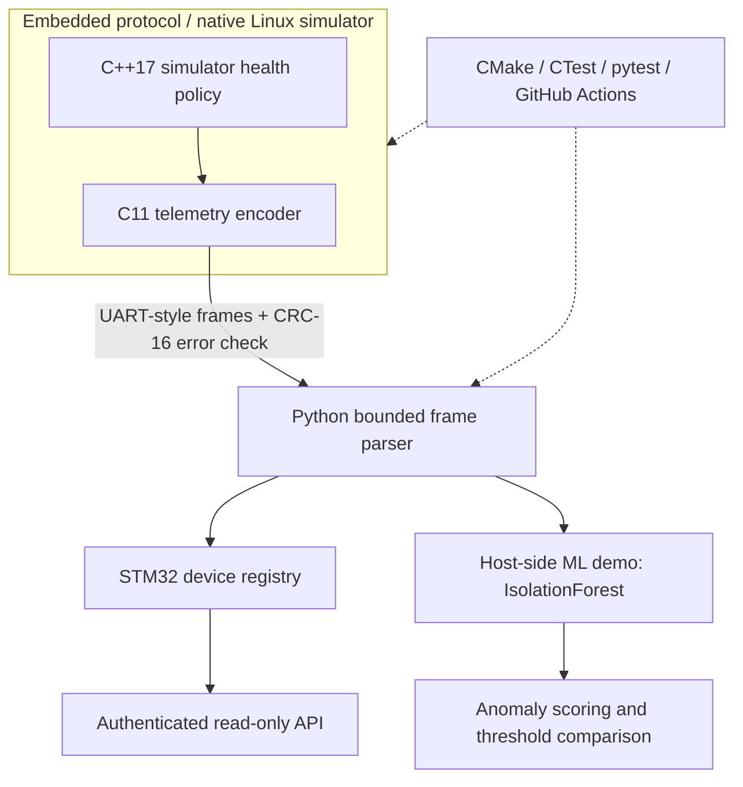

## Agent Lumos in Action

<p align="center">
  
</p>

*Animated terminal visualization of verified **host-simulator** output. Data is synthetic; the STM32 firmware has not yet been demonstrated on physical hardware. An ML anomaly is not proof of a cyberattack.*

### Reproduce the terminal demo

From the repository root, on Linux with CMake, Ninja, GCC/G++, Python 3.11+ and the ML dependencies installed:

```bash
python3 -m venv .venv
source .venv/bin/activate
python -m pip install -e '.[dev,stm32,ml]'
./scripts/portfolio_demo.sh
```

Optionally, regenerate a **real terminal recording** using [VHS](https://github.com/charmbracelet/vhs) and its prerequisites:

```bash
vhs docs/demo.tape
```

### Architecture overview



> **Security boundary:** CRC-16 detects accidental corruption; it does not authenticate the device. The STM32 HAL example and optional ARM/AArch64 assembly samples are not represented here as verified physical-device functionality.
